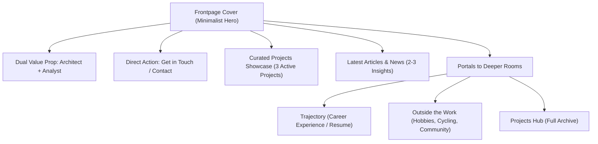

# Design Research & Strategic Proposals: The "Cover" Frontpage for Software Architect & Business Analyst

**Client:** Benjamin Sanchez Zebadua  
**Strategic Persona:** Software Engineer / Architect overlapping with Business Analyst Skills  
**Lead Designer:** Senior Creative Director & Front-End Solutions Architect  
**Deliverables Directory:** [`version2_research/`](file:///home/antigravity/neobenjax/benjamin-sanchez-zebadua/version2_research/)  
**Date:** November 2026 (2026 Award Standards Benchmark)

---

## 1. The Creative Pivot: Why Your Feedback Redefines the Architecture

Your feedback pinpointed the exact trap of modern digital portfolios:
1. **The FinTech Pigeonhole:** Over-indexing on wealth management created a corporate Wall-Street veneer that obscured your identity as an engineer who builds systems and an analyst who solves complex business puzzles.
2. **The "Text-Wall" Syndrome:** Portfolios loaded with paragraphs fail to engage senior executives and hiring leaders. Decisions are made in **3 to 7 seconds**. The frontpage must act as an alluring, high-status **Cover**—not an encyclopedia.
3. **The "Dark-Mode AI" Cliché:** Dark slate backgrounds with neon cyan glows have become the ubiquitous signature of auto-generated AI templates. They look identical, lack soul, and signal zero personal taste.
4. **The "Looking for Work" Stigma:** High-caliber architects and senior analysts do not put flashing "Open to Work" badges on their covers. Your portfolio is a personal exhibition of craft, trajectory, and thought leadership. Opportunities must come to you organically through the sheer quality of your presentation.

---

## 2. Research Benchmark: Deconstructing Minimalist Frontpage Covers

### A. The Benchmark Pioneer: Adham Dannaway ([adhamdannaway.com](https://www.adhamdannaway.com/))
*Audited via live capture: [`screenshots/adham_dannaway.png`](screenshots/adham_dannaway.png)*

```
+---------------------------------------------------------------+
|  Adham Dannaway      about · learn · portfolio · blog · contact|
+---------------------------------------------------------------+
|                                                               |
|        [ DESIGNER ]                 [ <CODER> ]              |
|   Product designer specialising    Front end developer who    |
|   in UI design & design systems.   writes clean, elegant code.|
|                                                               |
|                   ( INTERACTIVE SPLIT AVATAR )                 |
|                                                               |
+---------------------------------------------------------------+
|  Some of my latest work (3 curated cards with visual previews)|
+---------------------------------------------------------------+
|  Latest Articles & Design Systems                             |
+---------------------------------------------------------------+
```

**Why Adham Dannaway's Site Remains Legendary:**
* **Instant Hybrid Comprehension:** In literally 2 seconds, the visitor understands the dual-specialty without reading a paragraph. The interactive split visual immediately anchors the experience.
* **Radical Restraint:** The homepage is a **Cover**. It gives just enough taste of the work to invite you inward.
* **Balanced Architecture:** Navigation serves as doors to the deeper rooms: `About (Personal)`, `Portfolio (Full Archive)`, `Blog (Articles/News)`, `Contact`.

### B. Contemporary 2025–2026 Awwwards & Godly Winners (Light Mode & Minimalist Covers)
*Audited via live captures: [`screenshots/minimal_gallery.png`](screenshots/minimal_gallery.png), [`screenshots/rauno_minimal.png`](screenshots/rauno_minimal.png)*

1. **Rauno Freiberg (Design Engineer, ex-Vercel — Awwwards SOTD / Craft Honoree):**
   - *Aesthetic:* Warm off-white `#FAFAF9`, hyper-crisp typography, zero decorative clutter.
   - *Cover Mechanics:* Clean micro-interactions, spring-based cursor hovers, zero boilerplate text.
2. **Minimal Gallery & Scandinavian Portfolios (Huy Phan, Sam Dallyn, Studio K95):**
   - *Aesthetic:* High whitespace ratio (60%+ negative space), subtle ink borders (`rgba(0,0,0,0.06)`), soft organic typography.
   - *Storytelling:* Instead of telling the user "I am a leader", they demonstrate it through clarity of structure and curated project outcomes.

### C. Your Current Frontpage Baseline ([`screenshots/current_frontpage.png`](screenshots/current_frontpage.png) & [`screenshots/current_old_split_page.png`](screenshots/current_old_split_page.png))
- Your active design theme (**Mind Bubble Theme**) uses a crisp, refreshing palette:
  - Background: `--color-primary: #F4FAFA` (Ice/Mint light canvas)
  - Surface: `--color-surface: #FFFFFF` (Crisp white cards)
  - Text: `--color-text-primary: #0F172A` (Charcoal slate)
  - Accent: `--color-accent: #1E8F8F` (Subtle teal/emerald)
- **Takeaway:** This light, human color scheme is clean, distinctive, and distinctly *not* generic dark AI. We build directly upon this foundation.

---

## 3. The Frontpage Cover Architecture

Each of our 3 new proposals implements your required structure with zero wall-of-text:



---

## 4. The 3 Distinct Wireframe Proposals

### Proposal 1: "The Dual-Core Split Cover" (`proposal-1-split-cover.html`)
* **Concept:** Direct evolution of the Adham Dannaway paradigm reimagined for 2026.
* **Palette:** Fresh Ice Mint & Crisp White (`#F4FAFA` / `#FFFFFF` / Slate `#0F172A` / Accent `#1E8F8F`).
* **Cover Hero:**
  - Centerpiece interactive **Dual-Core Emblem**: Hovering the left half activates **Software Architect** (highlighting systems architecture, distributed backends, clean code). Hovering the right half activates **Business Analyst** (highlighting process engineering, stakeholder requirements, ROI modeling).
* **Sections:**
  1. *Curated Projects:* 3 high-impact project cards with image placeholders and clean tags.
  2. *Latest News & Articles:* 2 clean editorial cards with reading times.
  3. *Navigation Portals:* Distinct cards linking to **Trajectory & Experience**, **Life Outside Work (Cycling & Community)**, and **Full Projects Hub**.
  4. *Contact:* Clean, elegant contact drawer modal with email copy action.

### Proposal 2: "The Editorial Canvas & Monograph" (`proposal-2-editorial-canvas.html`)
* **Concept:** High-fashion Swiss editorial meets technical publication (inspired by Kinfolk & ReadCV).
* **Palette:** Warm Oat Paper (`#FAF9F6`), Deep Charcoal (`#18181B`), Warm Terracotta/Amber accent (`#C2410C`).
* **Cover Hero:**
  - Elegant serif title paired with an interactive **Dual-Perspective Lens Pill** (`Architectural Systems` $\leftrightarrow$ `Business Analysis`) that smoothly switches your one-sentence value proposition without reloading.
* **Sections:**
  1. *Curated Work Strip:* Interactive list where hovering each project reveals a floating cursor image preview.
  2. *Dispatches / Articles:* Minimalist two-column publication feed.
  3. *The Index:* Three clean accordion drawers: *01 / Career Trajectory*, *02 / Life Outside the Code*, *03 / Reach Out*.

### Proposal 3: "The Bento Papercraft & Spatial Light" (`proposal-3-bento-papercraft.html`)
* **Concept:** Clean tactile physical cards with subtle elevation, refined borders, and gentle spring physics (inspired by Apple Design Awards and Awwwards Clean 2026).
* **Palette:** Pure Cloud White (`#FFFFFF`), Soft Mist (`#F8FAFC`), Slate Gray (`#1E293B`), Cobalt Blue accent (`#2563EB`).
* **Cover Hero:**
  - A tactile Bento Cover combining:
    - *Card A (Hero):* Compact personal statement with interactive toggle between "Engineering Rigor" and "Strategic Analysis".
    - *Card B (Curated Projects):* Interactive multi-tab card previewing current projects.
    - *Card C (Latest Thoughts):* Compact news stream.
    - *Card D (Beyond the Desk):* Personal life highlight (CHEO Route Captain, avid reading, community).
    - *Card E (Quick Contact):* Instant contact modal trigger.

---

## 5. Requirements Compliance Matrix

| Requirement | Proposal 1: Split Cover | Proposal 2: Editorial Canvas | Proposal 3: Bento Papercraft |
| :--- | :---: | :---: | :---: |
| **No "Open to Work" / Hire Badges** | Passed (100% Removed) | Passed (100% Removed) | Passed (100% Removed) |
| **Light / Human Palette (No generic dark AI)** | Passed (Ice Mint `#F4FAFA`) | Passed (Oat Paper `#FAF9F6`) | Passed (Pure Mist `#FFFFFF`) |
| **Architect + Business Analyst Focus** | Passed (50/50 Dual-Core) | Passed (Dual-Perspective Lens) | Passed (Tactile Dual Pill) |
| **Minimal Cover Layout (Not text-heavy)** | Passed (High whitespace) | Passed (Editorial restraint) | Passed (Bento modularity) |
| **Curated Room for Projects** | Passed (3 Active Projects) | Passed (Hover-card preview strip)| Passed (Interactive tab strip) |
| **Latest News / Articles** | Passed (2 Editorial Cards) | Passed (Minimal Journal List) | Passed (Dispatches Tile) |
| **Pathways to Trajectory & Personal Life** | Passed (3 Dedicated Portals) | Passed (Interactive Index Drawers)| Passed (Direct Pathway Tiles) |
| **Direct Contact Action** | Passed (Modal + Clipboard) | Passed (Inline Drawer) | Passed (Quick-Action Drawer) |

---

## 6. Front-End Designer Pitch: How to Choose

Benjamin, this revised collection provides three radically different, non-dark, award-worthy interpretations of your identity:
- If you love the **Adham Dannaway interactive split mechanic** that establishes your dual identity in 2 seconds, choose **Proposal 1**.
- If you want an **editorial, high-status intellectual monograph** that looks like an architectural magazine, choose **Proposal 2**.
- If you want a **modern, tactile, modular bento cover** with interactive tabs and physical card elevation, choose **Proposal 3**.

You can explore all three live prototypes inside the interactive presentation hub:
👉 **[`version2_research/index.html`](file:///home/antigravity/neobenjax/benjamin-sanchez-zebadua/version2_research/index.html)**
